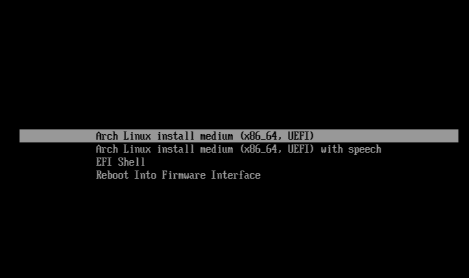
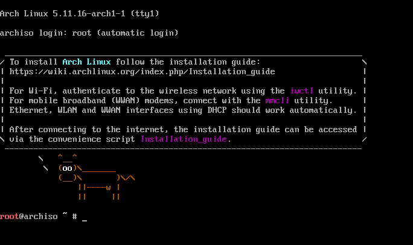
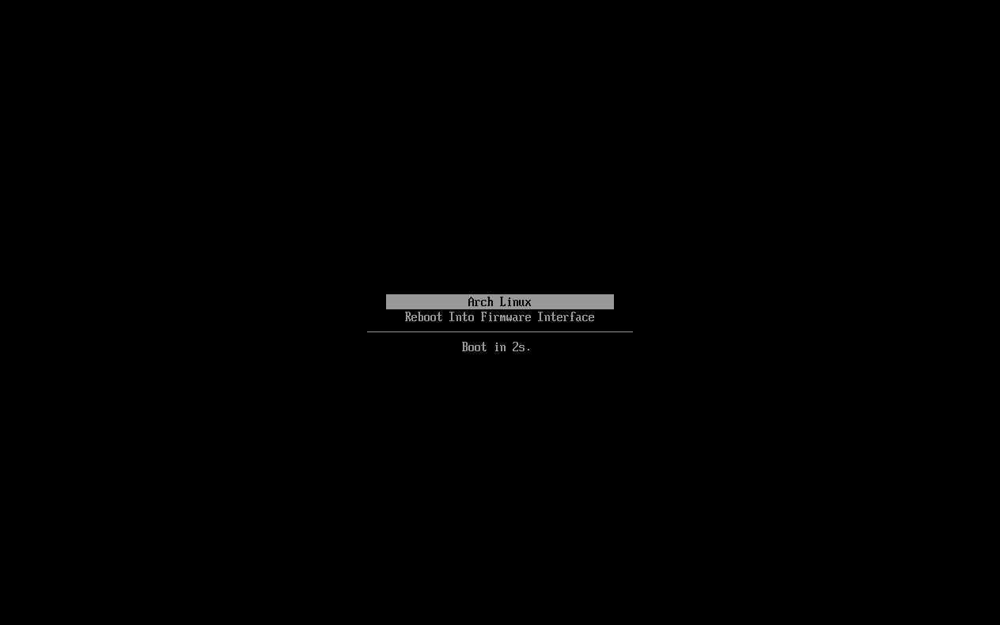
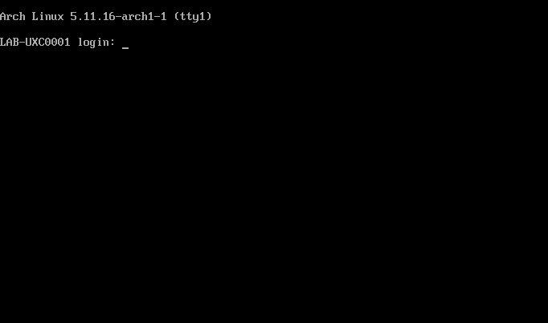

<h1 align="center">
   
   <br>
   <br>
      Building Arch Linux with systemd-boot
   <br>
</h1>

## Software and hardware specification for this build:

* Hostname: LAB-UXC0001
* RAM: 1GiB
* Storage: x1 qcow2 image 6GiB
* Network: Default nat virtual network
* CDROM drive for ISO using ARCH ISO
* Bootloader: systemd-boot
* Extra packages in build:
    * vi
 
## VM Build:

Using the above VM hardware settings, which came off the `archlinux` variant, build this VM:

```bash
sudo virt-install --name LAB-UXC0001 --os-variant archlinux --disk size=6 --cdrom archlinux-x86_64.iso --boot cdrom --boot uefi=on --cpu host-passthrough
```

## OS Build:

Verify the PGP signatures as per [the official instructions](https://wiki.archlinux.org/title/Installation_guide#Verify_signature)

1. Boot the OS from the liveCD and select the first boot option:

 

2. This should lead to the default shell:



3. (Optional): SSHD should be available on this VM if that is preferred and listening on the private inet address. This is accessible after setting the `root` password in the tty:

```bash
passwd
```

4. Change console keyboard layout:

```bash
loadkeys uk
```

5. I am using a UFI capable device so verify efivarfs variables are available and we are booted into an EFI system: 

```bash
efivar --list
cat /sys/firmware/efi/fw_platform_size
```

6. Configure the NTP client to sync from an NTP source and configure the time zone:

```bash
timedatectl set-timezone Europe/London
timedatectl set-ntp true
```

7. The partitioning and sizing is based on a 6GiB qcow2 image. The partitioning of the disk is as follows:

| Disk | Size |
| --- | --- |
/dev/vda | 6GiB

| Device | Partition Table |
| --- | --- |
/dev/vda | GPT

| Partition # | Sectors | Partition Type | Size |
| --- | --- | --- | --- |
1 | 2048 - 12582878 | EFI Filesystem | 300MiB
2 | 616448 - 12582878 | Linux Filesystem | 4.7GiB

* Set the disk partition table as GPT:

```bash
fdisk /dev/vda
: g
```

* Create the EFI partition:

```bash
: n
: 1
# Confirm default start sectors and then for end sectors:
: +300M
# Set the filesystem type to EFI Filesystem:
: t
: 1
```

* Create the Linux partition:

```bash
# Create the next partition and confirm the default start and end sectors:
: n
```

* Write the changes to disk:

```bash
: w
```

8. Format the partitions as follows:

| Partition # | File system|
| --- | --- |
1 | FAT32
2 | Ext4

* Create the EFI file system:

```bash
mkfs.fat -F32 /dev/vda1
```

* Create the Linux ext4 file system:

```bash
mkfs.ext4 /dev/vda2
```

9. Mount the file systems we've just created:

* Mount the root partition:

```bash
mount /dev/vda2 /mnt
```

* Create and mount the EFI partition 

```bash
# Create the directory:
mkdir /mnt/boot
# Mount the partition:
mount /dev/vda1 /mnt/boot
```

10. Now install the distribution to the /mnt directory:

```bash
# synchronise databases
pacman -Syy
# Install Arch Linux:
pacstrap /mnt linux linux-firmware base vi
```

11. Create the fstab file and update the file with the file systems configured:

```bash
genfstab -U /mnt >> /mnt/etc/fstab
```

12. Change root into the new system:

```bash
arch-chroot /mnt
```

13. Update the hardware clock from the system time:

```bash
# Create symlink from the zoneinfo location to the /etc/localtime:
ln -sf /usr/share/zoneinfo/Europe/London /etc/localtime
# Update the hw clock:
hwclock --systohc
```

> **Note::** Steps 14-16 are optional if swap is required.

14. Allocate the swap file space, set the permissions and create the swap file:

```bash
# Allocate the space:
fallocate --length 2GB /swapfile
# Set the permissions to the directory:
chmod 600 /swapfile
# Create the swapfile
mkswap /swapfile
```

15. : Enable swapping with the swapfile:

```bash
swapon /swapfile
```

16. Update fstab with the new swapfile:

```bash
vi /etc/fstab
# Add the below line:
/swapfile   none    swap    defaults 0 0
```

17. Generate the correct locale, mine is en_GB.UTF-8 UTF-8:

```bash
# Uncomment the locate from /etc/locale.gen:
en_GB.UTF-8 UTF-8
# Generate the locale:
locale-gen
```

18. Create the /etc/locale.conf locale config file and set the variable:

```bash
vi /etc/locale.conf
# Add in:
LANG=en_GB.UTF-8
```

19. Update the virtual console config file with the keymaps:

```bash
vi /etc/vconsole.conf
# Add in:
KEYMAP=uk
```

20. Update the hosts file:

```bash
vi /etc/hosts
# Add in
127.0.0.1	localhost
::1		localhost
127.0.1.1	LAB-UXC0001.localdomain	LAB-UXC0001
```

21. Set the hostname of the machine:

```bash
vi /etc/hostname
# Add in:
LAB-UXC0001
```

22. Set the root password:

```bash
passwd
```

23. Install the systemd bootloader:

```bash
# Install the bootloader to the /boot directory:
bootctl install --esp-path=/boot
```

24. Configure the systemd bootloader entry:

```bash
vi /boot/loader/entries/arch.conf
# Add in:
title Arch Linux
linux /vmlinuz-linux
initrd /initramfs-linux.img
options root=UUID=<uuid> rw loglevel=3 quiet
```

25. Configure the systemd bootloader runtime:

```bash
vi /boot/loader/loader.conf
# Add in:
default arch.conf
timeout 1
console-mode max
```

26. Unmount the current partitions:

```bash
exit
umount -R /mnt
```

27. Reboot into the new system and discard the liveCD:

```bash
reboot
```

sd-boot should be the next presented prompt, followed by the console:




